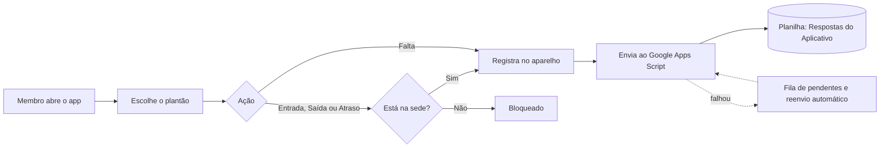

# Ponto Digital – Hidros Consultoria

Aplicativo web para registrar a presença dos membros da Hidros Consultoria (UERJ) nos plantões da sede. O membro toca em **Entrada**, **Saída**, **Entrada c/ Atraso** ou **Falta**, e o registro vai automaticamente para uma planilha do Google.

O app funciona direto no navegador do celular e pode ser instalado na tela inicial, como um aplicativo.

---

## Como funciona (visão geral)



| Peça | O que é | Onde fica |
|---|---|---|
| **App** | `index.html` (HTML, Tailwind via CDN e JavaScript puro), mais o manifesto e os ícones para instalação | GitHub Pages |
| **Script** | Google Apps Script publicado como aplicativo da Web, que recebe os registros | Conta Google da Hidros |
| **Planilha** | Google Sheets, aba `Respostas do Aplicativo` | Conta Google da Hidros |

---

## Regras do app

### Identificação
Na primeira vez, o membro escolhe o nome na lista (ou digita o e-mail institucional). A escolha fica salva só no aparelho dele.

### Plantões
O membro seleciona o bloco do dia. A lista fica na constante `SLOTS` do código.

| Bloco | Horário |
|---|---|
| M3-M4 | 08:50–10:40 |
| M4-M5 | 09:40–11:30 |
| M5-M6 | 10:40–12:30 |
| M6-T1 | 11:30–13:20 |
| T1-T2 | 12:30–14:20 |
| T2-T3 | 13:20–15:10 |
| T3-T4 | 14:20–16:10 |
| T4-T5 | 15:10–17:00 |
| T5-T6 | 16:10–18:00 |
| RG | 18:00–21:00 (reunião geral / evento) |

### Tolerância e atraso
- A tolerância é de **10 minutos** após o início do plantão (`TOLERANCE_MIN`).
- Se o membro tocar em **Entrada** depois disso, o app não registra direto: pede uma **justificativa oficial** e grava como **Entrada c/ Atraso**.
- O bloco `RG` não tem controle de tolerância.

### Localização (GPS)
- Entrada, Saída e Entrada c/ Atraso só funcionam com o membro **dentro de 350 m da sede** (`HQ` e `RADIUS_M`).
- Fora da sede esses três botões ficam desativados. **Falta** pode ser registrada de qualquer lugar.
- A posição é atualizada a cada 60 segundos e conferida de novo no instante do registro.
- É preciso permitir a localização no navegador, e o site precisa estar em `https` (o GitHub Pages já está).

### Falta
Ao tocar em **Falta**, o app mostra primeiro **5 cartões, de segunda a sexta, com a data de cada dia**, ligados ao calendário real. O membro escolhe o dia da falta (dá para navegar para a semana anterior ou a próxima; aos sábados e domingos o app já mostra a semana seguinte). Dias que já têm Falta ou Entrada registrada no aparelho ficam desativados.

Depois da escolha do dia, o app pede uma **justificativa oficial** (lista de 15 opções, mais um campo livre opcional). O botão **← Trocar dia** permite voltar. O registro grava o dia escolhido, e a semana e o dia da semana na planilha são calculados a partir dele. Falta pode ser registrada de qualquer lugar.

### Comprovante e histórico
- Cada registro gera um **comprovante** com data, hora, plantão, local e um código (hash) de identificação. Ele abre assim que o ponto é registrado, antes de qualquer outra etapa, e também pode ser aberto de novo pela aba Histórico.
- A aba **Histórico** mostra os registros daquele aparelho, com filtros por texto, tipo e data, e a situação do envio à planilha.
- A aba **Limpeza** está reservada para uma funcionalidade futura.

---

## Envio para a planilha

1. O app monta o registro e envia com `fetch` (método POST) para o endereço do Apps Script.
2. Cada registro tem um **identificador único**. Se o app reenviar o mesmo registro, o script reconhece e **não duplica a linha** (controle de 6 horas).
3. Se a resposta confirmar, o registro fica como **✓ Planilha**. Se não for possível ler a resposta, fica como **Enviado?**. Se falhar, fica **Pendente**.
4. Registros pendentes são reenviados sozinhos ao abrir o app, quando a internet volta e ao tocar em **Reenviar agora** na aba Histórico.
5. O registro **nunca espera** a checagem de conexão: o ponto é salvo no aparelho, o comprovante abre na hora e o envio acontece em segundo plano.
6. O indicador no topo mostra se a planilha está acessível. O app abre já como **Planilha OK** e confirma a conexão em segundo plano, tentando de novo sozinho (a cada 3 segundos, até 8 vezes) se o Google demorar. Só fica vermelho (offline) se a conexão falhar de verdade, e amarelo se a URL não estiver configurada.

### Colunas gravadas na aba `Respostas do Aplicativo`

| Coluna | Conteúdo |
|---|---|
| A | Data e hora |
| B | E-mail |
| C | Nome. **O script não escreve aqui**: use uma fórmula que relacione o e-mail (coluna B) ao nome do membro |
| D | Semana do mês com o intervalo, calculada pelo app. Ex.: `3ª Semana (16/11 a 20/11)`. No bloco `RG` grava "Mês Inteiro" |
| E | Dia da semana |
| F | Horário de plantão com os horários. Ex.: `T5-T6 (16:10 - 18:00)` |
| G | Tipo: Entrada, Entrada c/ Atraso, Saída ou Falta |
| H | Justificativa de atraso |
| I | Justificativa de falta |
| J | Pontuação. **O script não escreve aqui**: use uma fórmula própria |

O script grava só nas colunas A, B e D a I, na **primeira linha livre** (olhando a coluna B). Por isso as fórmulas das colunas C e J, já preenchidas até o fim da tabela, não atrapalham.

### Como as semanas são contadas
Cada mês é dividido em blocos de segunda a sexta, cortados nos limites do mês. Exemplo, novembro de 2026: 1ª semana 02 a 06, 2ª 09 a 13, 3ª 16 a 20, 4ª 23 a 27 e 5ª apenas 30/11. O app não desconta feriados.

---

## Configuração

### No app (`index.html`)
Tudo fica no bloco `CONFIG` no início do `<script>`:

```js
const CONFIG = {
  WEBHOOK_URL: '...',   // endereço /exec do Apps Script
  TOKEN: '...',         // tem que ser igual ao TOKEN do Código.gs
  HQ: { lat: -22.9122, lng: -43.2358 },
  RADIUS_M: 350,
  TOLERANCE_MIN: 10
};
```

A lista de membros (`MEMBERS`), os plantões (`SLOTS`) e as justificativas (`REASONS`) ficam logo abaixo.

### No Google Apps Script (`Código.gs`)
1. Abra a planilha e vá em **Extensões → Apps Script**.
2. Cole o código do script (`Codigo_v5.gs`) e confira o `TOKEN` e o nome da aba.
3. Clique em **Implantar → Nova implantação → Aplicativo da Web**:
   - **Executar como:** Eu
   - **Quem pode acessar:** Qualquer pessoa
4. Copie o endereço terminado em `/exec` e cole em `WEBHOOK_URL`.

> **Atenção ao alterar o script:** salvar o código **não** publica a mudança. O app usa a versão publicada, e só o botão de testar no editor usa o código salvo. Depois de qualquer mudança, use **Implantar → Gerenciar implantações → editar (lápis) → Nova versão**. Assim a URL continua a mesma e o app não precisa ser atualizado. Criar uma implantação nova gera outra URL, e nesse caso é preciso trocar o `WEBHOOK_URL` no `index.html` e avisar os membros para reabrir o app.

**Conferir a versão publicada:** abra o endereço `/exec` do script no navegador. A resposta traz a versão (por exemplo, `"versao":"v5.1"`). Se a versão não aparecer, a implantação ainda está com o código antigo.

**Manter o script acordado:** o Google "adormece" scripts parados, e a primeira chamada depois disso pode demorar. Para evitar, o script tem a função `manterAcordado`. Crie um acionador (ícone do relógio) com essa função, **Baseado em tempo**, **A cada 5 minutos**, e na primeira vez execute a função e aceite as permissões.

---

## Rotina mensal: trocar de planilha

O endereço do script (`WEBHOOK_URL`) **nunca muda**. O que muda por mês é só a planilha onde o script grava, definida na propriedade `SPREADSHEET_ID`.

**Uma vez só:** no Apps Script, abra **⚙ Configurações do projeto → Propriedades do script** e adicione `SPREADSHEET_ID` com o ID da planilha do mês (o trecho do link entre `/d/` e `/edit`). Depois use **Implantar → Gerenciar implantações → editar → Nova versão**.

**Todo mês:**
1. Faça uma cópia da planilha e apague as linhas antigas só nas colunas A, B e D a I (mantenha as fórmulas de C e J).
2. Copie o ID da planilha nova.
3. Cole o ID na propriedade `SPREADSHEET_ID`. Vale na hora, sem nova versão e sem mexer no app.
4. Execute a função `qualPlanilha` para conferir em qual planilha o app está gravando.

**Cuidados:** mantenha a planilha original, porque o script mora nela. Faça a troca fora do horário de uso. Se o ID estiver errado, os registros ficam como pendentes no aparelho e são reenviados depois que o ID for corrigido.

---

## Publicação e instalação no celular

**Atualizar o app:** edite o `index.html` no GitHub (lápis → colar o código → *Commit changes*). O GitHub Pages publica a nova versão em 1 a 2 minutos, e quem abrir o app já recebe a atualização.

**Arquivos do repositório (todos na raiz, ao lado do `index.html`):**

| Arquivo | Para que serve |
|---|---|
| `index.html` | O app |
| `manifest.webmanifest` | Diz ao navegador que o app é instalável (nome, cores, ícones) |
| `icon-192.png`, `icon-512.png`, `icon-maskable-512.png` | Ícones do app no Android |
| `apple-touch-icon.png` | Ícone do app no iPhone |

Sem o manifesto e os ícones, o Chrome cria apenas um atalho com a letra "G" em vez de instalar o app. O arquivo principal precisa se chamar exatamente `index.html`.

**Instalar no celular:**
- **Android (Chrome):** abrir o link, esperar alguns segundos, tocar nos três pontinhos e em **Instalar app** (não em "Adicionar à tela inicial", que cria só um atalho).
- **iPhone (Safari):** abrir o link no Safari, tocar em Compartilhar e em *Adicionar à Tela de Início*.

**Se o app instalado parecer antigo:** feche por completo e abra de novo. Se persistir, desinstale, limpe os dados do site em Configurações do Chrome e instale de novo. O histórico local do aparelho é apagado nesse processo, mas o que já foi enviado continua na planilha.

---

## Limitações e cuidados

- **O GPS não é à prova de fraude.** A conferência de local acontece no aparelho do membro e pode ser contornada por quem souber. Ela dificulta o registro à distância, mas não o impede por completo. Também só confere a presença na hora do registro, não entre a Entrada e a Saída.
- **Segurança do repositório.** O `TOKEN` e o endereço do script ficam visíveis no código. Se o repositório for público, qualquer pessoa pode ver essas informações e tentar enviar registros falsos. A lista de e-mails dos membros também fica à vista.
- **Identificação por escolha.** O membro escolhe o próprio nome na lista, então nada impede alguém de escolher o de outra pessoa.
- **Planilha não aparece no app.** O app não mostra link da planilha, porque nem todos os membros têm acesso a ela.
- **Histórico por aparelho.** O histórico da aba Histórico fica apenas no celular de quem registrou, separado por endereço do app. Desinstalar o app ou limpar os dados do site apaga esse histórico local. A fonte oficial dos dados é a planilha.
- **iPhone.** O app instalado guarda os dados separados do Safari, então a identificação e a permissão de localização precisam ser feitas de novo dentro do app.

---

## Ideias em estudo (ainda não implementadas)

- **Modo férias:** ativado por uma caixinha na planilha, com plantões ajustados ao período (sem o horário de almoço), uma única Entrada e Saída para dois plantões seguidos, e cálculo de quantos plantões foram cumpridos.
- **Círculo de presença:** indicador percentual de presença de cada membro ao longo das semanas, calculado a partir da planilha.

---

Projeto desenvolvido para a **Hidros Consultoria** (Empresa Júnior da UERJ).
