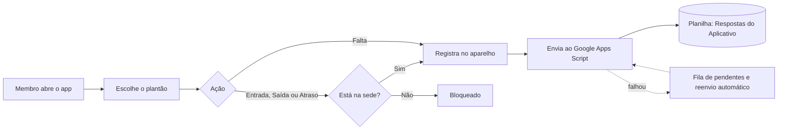

# Ponto Digital – Hidros Consultoria

Aplicativo web para registrar a presença dos membros da Hidros Consultoria (UERJ) nos plantões da sede. O membro toca em **Entrada**, **Saída**, **Entrada c/ Atraso** ou **Falta**, e o registro vai automaticamente para uma planilha do Google.

O app funciona direto no navegador do celular e pode ser instalado na tela inicial, como um aplicativo.

---

## Como funciona (visão geral)



| Peça | O que é | Onde fica |
|---|---|---|
| **App** | Um único arquivo `index.html` (HTML, Tailwind via CDN e JavaScript puro) | GitHub Pages |
| **Script** | Google Apps Script publicado como aplicativo da Web, que recebe os registros | Conta Google da Hidros |
| **Planilha** | Google Sheets, aba `Respostas do Aplicativo` | Conta Google da Hidros |

---

## Regras do app

### Identificação
Na primeira vez, o membro escolhe o nome na lista (ou digita o e-mail institucional). A escolha fica salva só no aparelho dele.

### Plantões
O membro seleciona o bloco do dia. A lista fica na constante `SLOTS` do código.

| Bloco | Horário |
|---|---|
| M3-M4 | 08:50–10:40 |
| M4-M5 | 09:40–11:30 |
| M5-M6 | 10:40–12:30 |
| M6-T1 | 11:30–13:20 |
| T1-T2 | 12:30–14:20 |
| T2-T3 | 13:20–15:10 |
| T3-T4 | 14:20–16:10 |
| T4-T5 | 15:10–17:00 |
| T5-T6 | 16:10–18:00 |
| RG | 18:00–21:00 (reunião geral / evento) |

### Tolerância e atraso
- A tolerância é de **10 minutos** após o início do plantão (`TOLERANCE_MIN`).
- Se o membro tocar em **Entrada** depois disso, o app não registra direto: pede uma **justificativa oficial** e grava como **Entrada c/ Atraso**.
- O bloco `RG` não tem controle de tolerância.

### Localização (GPS)
- Entrada, Saída e Entrada c/ Atraso só funcionam com o membro **dentro de 350 m da sede** (`HQ` e `RADIUS_M`).
- Fora da sede esses três botões ficam desativados. **Falta** pode ser registrada de qualquer lugar.
- A posição é atualizada a cada 60 segundos e conferida de novo no instante do registro.
- É preciso permitir a localização no navegador, e o site precisa estar em `https` (o GitHub Pages já está).

### Falta
Exige uma justificativa oficial (lista de 15 opções, mais um campo livre opcional).

### Comprovante e histórico
- Cada registro gera um **comprovante** com data, hora, plantão, local e um código (hash) de identificação.
- A aba **Histórico** mostra os registros daquele aparelho, com filtros por texto, tipo e data, e a situação do envio à planilha.
- A aba **Limpeza** está reservada para uma funcionalidade futura.

---

## Envio para a planilha

1. O app monta o registro e envia com `fetch` (método POST) para o endereço do Apps Script.
2. Cada registro tem um **identificador único**. Se o app reenviar o mesmo registro, o script reconhece e **não duplica a linha** (controle de 6 horas).
3. Se a resposta confirmar, o registro fica como **✓ Planilha**. Se não for possível ler a resposta, fica como **Enviado?**. Se falhar, fica **Pendente**.
4. Registros pendentes são reenviados sozinhos ao abrir o app, quando a internet volta e ao tocar em **Reenviar agora** na aba Histórico.
5. O indicador no topo mostra se a planilha está acessível: verde (OK), vermelho (offline) ou amarelo (verificando ou URL não configurada).

### Colunas gravadas na aba `Respostas do Aplicativo`

| Coluna | Conteúdo |
|---|---|
| A | Data e hora |
| B | E-mail |
| C | Nome (o script só preenche se a célula não tiver fórmula) |
| D | Semana do mês (usa a aba `Instruções` se existir; no bloco `RG` grava "Mês Inteiro") |
| E | Dia da semana |
| F | Horário de plantão (código do bloco, ex.: `M3-M4`) |
| G | Tipo: Entrada, Entrada c/ Atraso, Saída ou Falta |
| H | Justificativa de atraso |
| I | Justificativa de falta |
| J | Pontuação: 0,5 para Entrada e Entrada c/ Atraso; 0 nos demais (o script só preenche se a célula não tiver fórmula) |

O script grava na **primeira linha livre**, olhando a coluna B. Por isso fórmulas já preenchidas nas colunas C e J não atrapalham.

---

## Configuração

### No app (`index.html`)
Tudo fica no bloco `CONFIG` no início do `<script>`:

```js
const CONFIG = {
  WEBHOOK_URL: '...',   // endereço /exec do Apps Script
  TOKEN: '...',         // tem que ser igual ao TOKEN do Código.gs
  SHEET_URL: '...',     // link da planilha (botão "Abrir Planilha")
  SHEET_TAB: 'Respostas do Aplicativo',
  HQ: { lat: -22.9122, lng: -43.2358 },
  RADIUS_M: 350,
  TOLERANCE_MIN: 10
};
```

A lista de membros (`MEMBERS`), os plantões (`SLOTS`) e as justificativas (`REASONS`) ficam logo abaixo.

### No Google Apps Script (`Código.gs`)
1. Abra a planilha e vá em **Extensões → Apps Script**.
2. Cole o código do script e confira o `TOKEN` e o nome da aba.
3. Clique em **Implantar → Nova implantação → Aplicativo da Web**:
   - **Executar como:** Eu
   - **Quem pode acessar:** Qualquer pessoa
4. Copie o endereço terminado em `/exec` e cole em `WEBHOOK_URL`.

> **Atenção ao alterar o script:** depois de qualquer mudança, use **Implantar → Gerenciar implantações → editar → Nova versão**. Assim a URL continua a mesma e o app não precisa ser atualizado. Criar uma implantação nova gera outra URL.

---

## Publicação e instalação no celular

**Atualizar o app:** edite o `index.html` no GitHub (lápis → colar o código → *Commit changes*). O GitHub Pages publica a nova versão em 1 a 2 minutos, e quem abrir o app já recebe a atualização.

**Instalar no celular:**
- **Android (Chrome):** abrir o link, tocar nos três pontinhos e em *Instalar app*.
- **iPhone (Safari):** abrir o link no Safari, tocar em Compartilhar e em *Adicionar à Tela de Início*.

O ícone e o manifesto do app são gerados pelo próprio código no aparelho, então não há arquivos extras a manter.

---

## Limitações e cuidados

- **O GPS não é à prova de fraude.** A conferência de local acontece no aparelho do membro e pode ser contornada por quem souber. Ela dificulta o registro à distância, mas não o impede por completo. Também só confere a presença na hora do registro, não entre a Entrada e a Saída.
- **Segurança do repositório.** O `TOKEN` e o endereço do script ficam visíveis no código. Se o repositório for público, qualquer pessoa pode ver essas informações e tentar enviar registros falsos. A lista de e-mails dos membros também fica à vista.
- **Identificação por escolha.** O membro escolhe o próprio nome na lista, então nada impede alguém de escolher o de outra pessoa.
- **Histórico por aparelho.** O histórico da aba Histórico fica apenas no celular de quem registrou. A fonte oficial dos dados é a planilha.
- **iPhone.** O app instalado guarda os dados separados do Safari, então a identificação e a permissão de localização precisam ser feitas de novo dentro do app.

---

## Ideias em estudo (ainda não implementadas)

- **Modo férias:** ativado por uma caixinha na planilha, com plantões ajustados ao período (sem o horário de almoço), uma única Entrada e Saída para dois plantões seguidos, e cálculo de quantos plantões foram cumpridos.
- **Círculo de presença:** indicador percentual de presença de cada membro ao longo das semanas, calculado a partir da planilha.

---

Projeto desenvolvido para a **Hidros Consultoria** (Empresa Júnior da UERJ).
